# Vanthrex – IBM i Development Tools for VS Code

**Modern IBM i (AS400) development in Visual Studio Code.** Browse libraries, source members and the IFS, edit and compile RPGLE, CL and SQL with errors on the right line, understand programs with a call graph, catch mistakes while you type, and get help from an AI assistant that keeps your data private. Free and open source.

[](https://marketplace.visualstudio.com/items?itemName=gauravgupta0612.vanthrex-ibmi) [](https://marketplace.visualstudio.com/items?itemName=gauravgupta0612.vanthrex-ibmi) [](https://gauravgupta0612.github.io/vanthrex-ibmi-docs/) [](LICENSE) [](https://github.com/gauravgupta0612/silverlake-ibmi/actions/workflows/ci.yml)

## Install in one minute

1. **Install** from the **[VS Code Marketplace](https://marketplace.visualstudio.com/items?itemName=gauravgupta0612.vanthrex-ibmi)**, or in a terminal:

   ```
   code --install-extension gauravgupta0612.vanthrex-ibmi
   ```

2. **Connect:** click the **Vanthrex** icon in the activity bar → **Add IBM i Connection…** → host, user, password or SSH key → **Test connection**.
3. **Work:** open a member from *Libraries & Source*, edit, save with `Ctrl+S`, compile with `Ctrl+Alt+C`. Press **`Ctrl+Alt+A`** at any time to see every tool that fits the file you are in.

**Coming from Code for IBM i?** Run **Import My Code for IBM i Setup…**: your connections, library lists and compile actions are ready in Vanthrex in one step. A team can share its whole setup with **Export a Team Setup File…**.

Offline install: download the `.vsix` from [Releases](https://github.com/gauravgupta0612/silverlake-ibmi/releases), then **Extensions** → `…` → **Install from VSIX…**. What the IBM i needs is in [Requirements](#requirements-on-the-ibm-i).

## See it in action

**Checks while you type, with the fix one click away** — more than 50 checks for RPG, CL and SQL, shown in *Problems*:

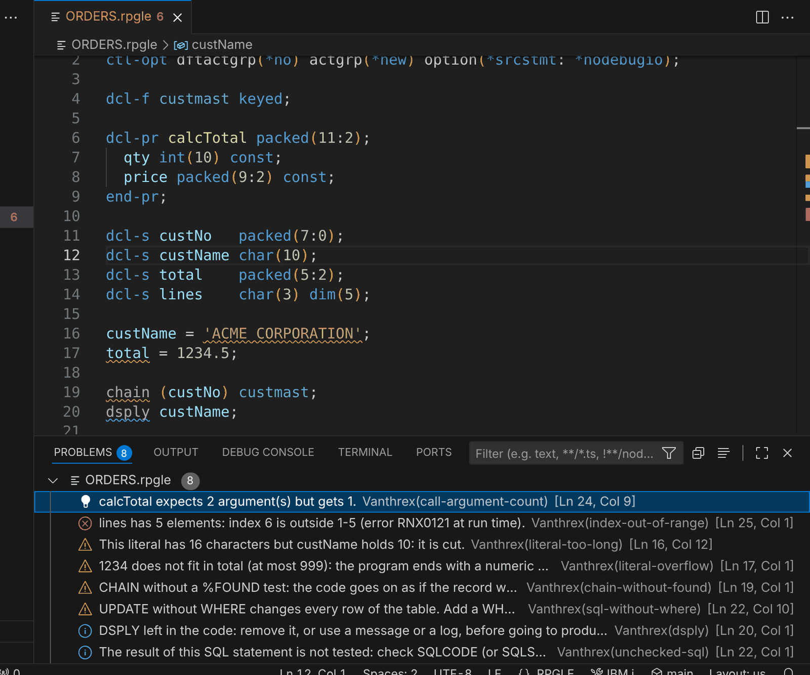

**Quick fixes** — `Ctrl+.` on a warning adds the missing code for you:

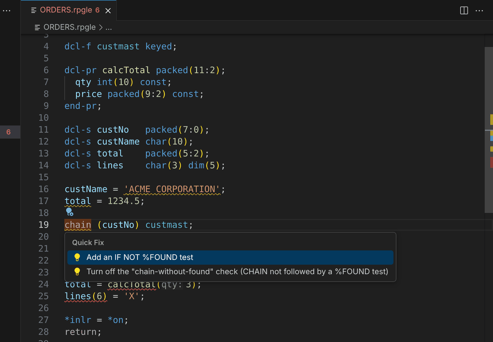

**Suggestions while you type** — the next line an IBM i developer would write, accepted with `Tab`:

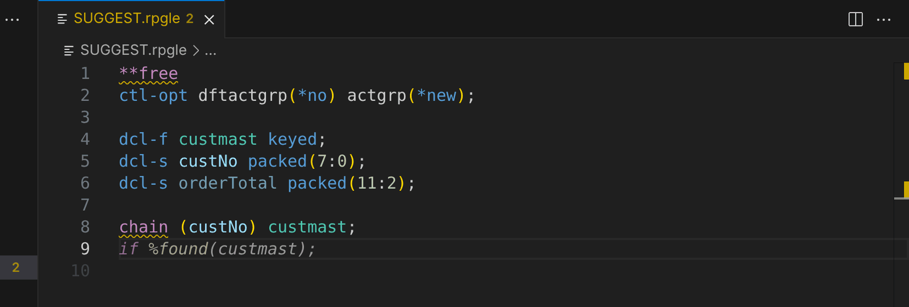

**Every tool in one menu** — `Ctrl+Alt+A` shows the tools that fit the file you are in:

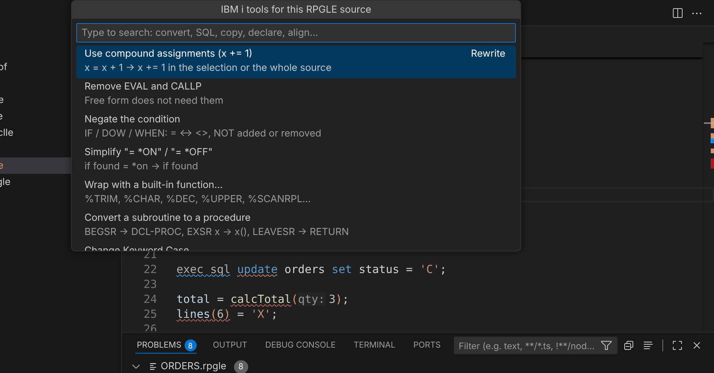

| CL checks | SQL checks |
|---|---|
| 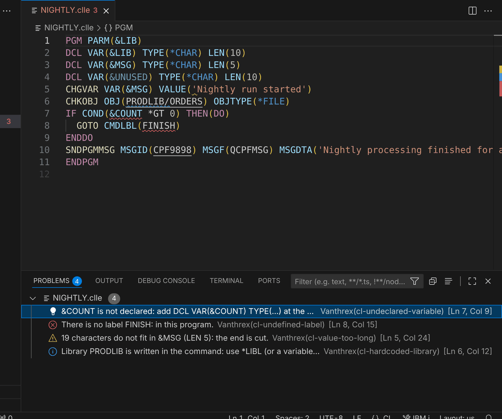 | 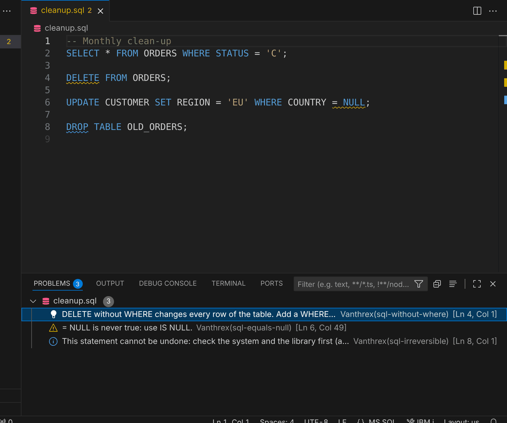 |
| **Connect in a minute** | **Team coding standards** |
| 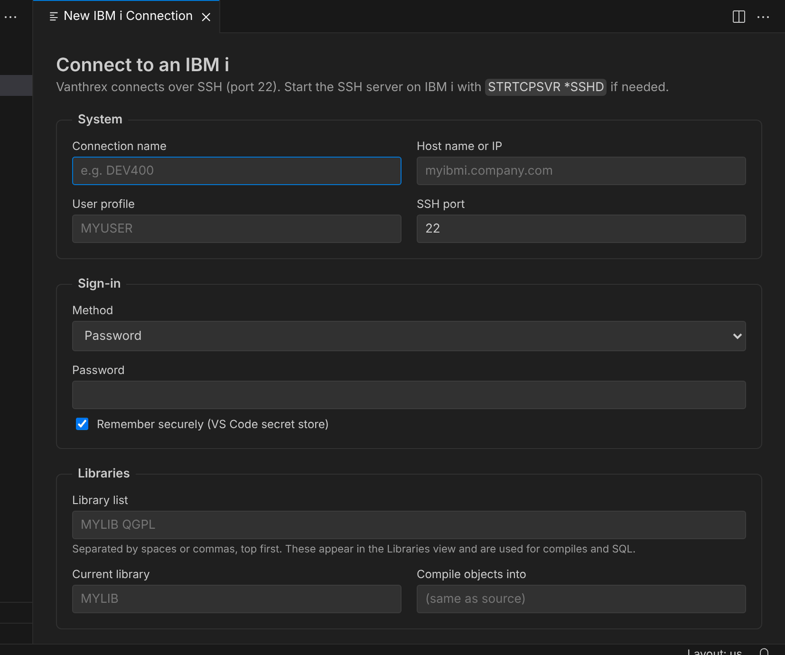 | 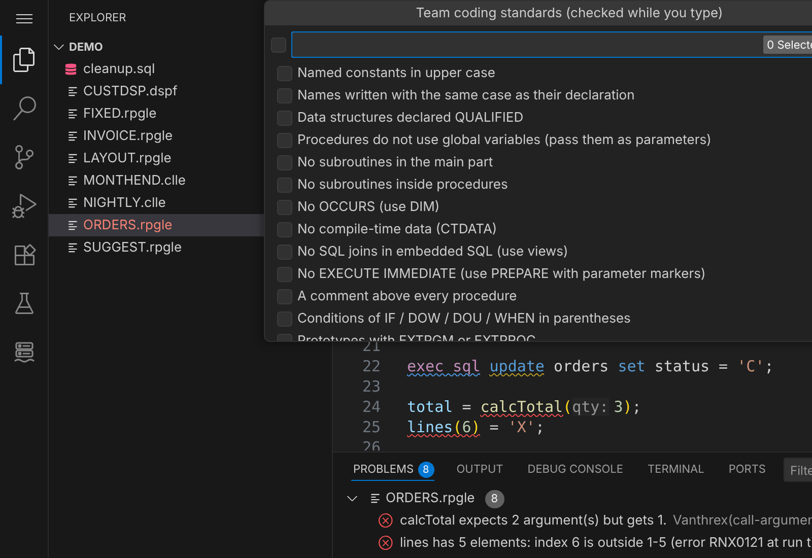 |
| **DDS checks (new in 3.1)** | **Format Document for CL (new in 3.1)** |
| 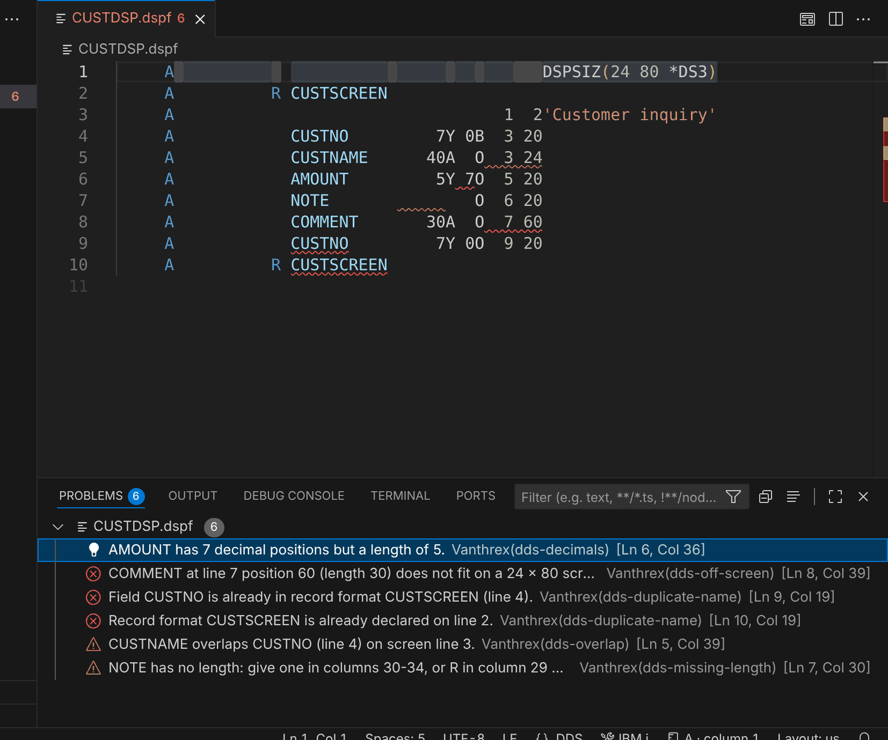 | 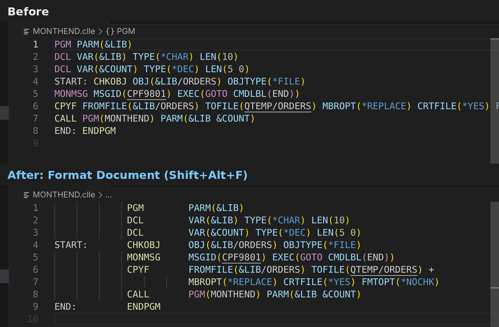 |
| **Fixed → free in one command** | **Flowchart of a procedure** |
| 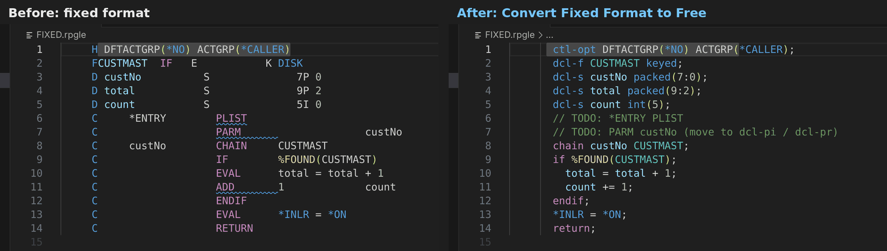 | 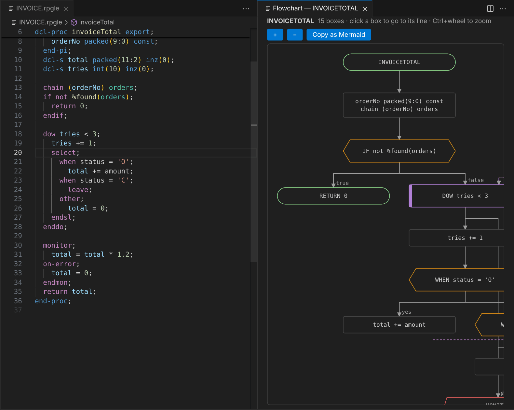 |

More in the [screenshot gallery](https://gauravgupta0612.github.io/vanthrex-ibmi-docs/screenshots.html), and [try it with example sources](https://gauravgupta0612.github.io/vanthrex-ibmi-docs/examples.html) — no IBM i needed.

## Why teams use it

- **Fewer errors reach production.** More than 50 checks run while you type in RPG, CL and SQL — prototypes that no longer match, wrong argument counts, `%SUBST` or array index out of range, numeric overflow, `UPDATE` / `DELETE` without `WHERE`, undeclared CL variables — most with a one-click fix.
- **Faster everyday work.** Suggestions while you type (`IF %FOUND` after `CHAIN`, an SQLCODE test after embedded SQL, `MONMSG` after `CHKOBJ`…), code generated from data structures and tables, fix-all commands and one menu (`Ctrl+Alt+A`) for every tool.
- **Understand any application.** Call graph and impact analysis, where used, who calls each exported procedure, flowcharts of procedures, data structure layouts and database diagrams.
- **Easier for new developers.** A modern editor with outline, go to definition, hovers that explain codes and messages, F4 prompters and guided forms, next to familiar PDM options and SEU-style source dates.
- **Safe with production and with AI.** Connections marked *Production* ask before every change; the AI never sees passwords, keys, personal data or host names, production stays limited to metadata, and every AI request is logged.
- **No licence cost**, and the interface in English, French, Spanish, German, Italian, Portuguese (Brazil), Japanese and Simplified Chinese.

## What you can do

| You want to… | Vanthrex gives you |
|---|---|
| **Explore the system** | Libraries & source, IFS, spooled files, PDM in one screen, object and source search, Go to Anything (`Ctrl+Alt+J`), System Tracker and dashboard, jobs, messages and a 5250 session in one click. |
| **Write RPG, CL and SQL** | Free and fixed format, outline, go to definition into /COPY members, rename, F4 prompters, column hints, fixed → free conversion, snippets, suggestions while typing, Surround With, IF → SELECT, toggle value and the [Developer Toolbox](https://gauravgupta0612.github.io/vanthrex-ibmi-docs/features-2-6.html). |
| **Compile and fix** | `Ctrl+Alt+C` with the right command for the source type, errors inline and in *Problems*, compile history, objects out of date with their source, local Git folders deployed to the IFS. |
| **Check quality** | Code checks with quick fixes, team coding standards (or your rpglint.json), a code health report of a whole library, metrics with grades, unused code and copybooks, binder source and prototype copybooks from the exports. |
| **Work with Db2 for i** | SQL with autocomplete, results grid, Explain and index advisor, table data editor, generate DDL, compare data between systems, export to Excel / CSV / JSON. |
| **Understand dependencies** | Call graph (programs, service programs, files), where used, callers of each exported procedure, signature checks, CRUD matrix and database diagrams. |
| **Run and debug** | Run CL with your library list, call a program with its real parameter types, step-through debugging of RPG, COBOL and CL. |
| **Operate the system** | Work with subsystems, job queues, output queues, user profiles, system values, journals, authorities, storage and live alerts. |
| **Use AI safely** | `@vanthrex` in the chat: explain, document, review, modernize, write tests, fix compile errors, write SQL against your real tables — with your data protected. |

> **New in 3.1:** **DDS checks while you type** (PF, LF, DSPF, PRTF), **Format Document for CL**, **RPG semantic highlighting**, DCL-PROC / END-PROC names edited together, END lines indented as you type, **links that open a member at a line** and clickable members, message IDs and IFS paths in the terminal. **In 3.0:** AS/400 GO menus, import from Code for IBM i, team setup files, team coding standards and a code health report. See [what is new in 3.1](https://gauravgupta0612.github.io/vanthrex-ibmi-docs/features-3-1.html), [in 3.0](https://gauravgupta0612.github.io/vanthrex-ibmi-docs/features-3-0.html) and the [changelog](CHANGELOG.md).

## Who it is for

Developers and teams working with **IBM i (AS400, iSeries)**: **RPGLE** and **free-form RPG**, **ILE RPG**, **SQLRPGLE**, **CL / CLLE**, **DDS**, **Db2 for i** SQL, the **IFS** and source physical files — RPG developers, technical leads, IBM i consultants and administrators who want a modern **VS Code** workflow instead of, or next to, PDM and SEU, and teams working on **IBM i modernization**.

## All features by area and version

Every feature with *why* and *how* is in the **[Feature Guide](FEATURES.md)** and the **[documentation](https://gauravgupta0612.github.io/vanthrex-ibmi-docs/)**.

| Area | What you get |
|---|---|
| **AI assistant** *(new in 0.6)* | `@vanthrex` in the VS Code chat: `/explain`, `/document`, `/review`, `/modernize`, `/test` (RPGUnit), `/fix` compile errors, `/sql` against your real tables, `/object`. It looks things up on the connected system (read-only, with confirmation) and its tools also work in Copilot agent mode. |
| **Call graph & impact** | Interactive diagram of callers and callees (programs, service programs, files with their usage), several levels deep, with *Copy as Mermaid*. *New in 0.7:* **Find dynamic calls** shows calls whose program name is in a variable. |
| **Who calls each exported procedure?** *(new in 0.7)* | For a service program: every program, source line and statement that calls each exported procedure — prototypes and /COPY members included — and the exports nobody calls. |
| **Several systems at once** *(new in 0.6)* | Stay connected to DEV, TEST and PROD and switch instantly; files always save to the system they came from. |
| **SQL Explain** *(new in 0.6)* | Table scans, indexes used, temporary indexes, sorts and advised indexes for a query, with `CREATE INDEX` suggestions. |
| **Connect** | Guided form with **Test connection**, SSH password or key, passwords in the VS Code secret store, status-bar quick menu (`Ctrl+Alt+I`), optional auto-reconnect. |
| **Browse** | *Libraries & Source* (source files, members, objects), *IFS Browser*, *My Spooled Files*. Find a member by pattern across your library list. |
| **Edit** | Members and IFS files open like local files; `Ctrl+S` saves to the IBM i. New RPG and CL members start from a template that compiles as-is. |
| **Compile** | `Ctrl+Alt+C`. The command is chosen from the source type, you pick once when several fit, and errors from EVFEVENT appear inline and in *Problems*. |
| **SQL** | **Run SQL Query…** (right-click a library, file, member or object, or in the call graph) opens an SQL editor with ready-made queries and the results underneath. `Ctrl+Enter` runs the statement under the cursor. Results grid with sort, filter, copy and CSV export. Confirmation before destructive statements. `ibmi-…` snippets for IBM i Services. |
| **CL** | `Ctrl+Alt+L` runs a CL command with your library list and keeps a history. |
| **Spool** | Open, save or delete your spooled files. |
| **RPG** | Highlighting for free and fixed format, outline and breadcrumbs, hovers for BIFs and opcodes, **column hints on fixed-format specs**, `%` completion, snippets, and **fixed → free** conversion of H, F, D, P and C specs. |
| **CL / DDS** | Syntax highlighting and snippets. |
| **System dashboard** *(new)* | CPU, system ASP, jobs, memory, top CPU jobs, latest QSYSOPR messages and PTF group levels, refreshing automatically. |
| **Jobs & messages** *(new)* | *Active Jobs* view (yours, a user, a subsystem or all): job log, hold, release, end. *Messages* view for QSYSOPR and your own queue: messages waiting for an answer come first and you reply in two clicks. |
| **Table data editor** *(new)* | Open any physical file or table in a grid: filter with a WHERE clause, page through rows, edit cells, add and delete rows. Values are checked against the column type before anything is written. |
| **Object & source search** *(new)* | `Ctrl+Alt+O` finds objects by name or text across your library list or all user libraries. `Ctrl+Alt+F` searches the source code of members. **Where used** lists the programs that reference a file or program. **Open program source** jumps from a *PGM to the member it was compiled from. |
| **RPG navigation** *(new)* | Go to definition (F12, also into /COPY members), find all references, rename (F2, scoped to the procedure), highlight occurrences, Ctrl+click on /COPY and /INCLUDE, and hover a name to see its declaration. |
| **SQL autocomplete** *(new)* | Table and view names after FROM/JOIN/INTO/UPDATE, columns after `alias.`, columns of the tables in your statement, and hover for column types and descriptions. |
| **Local history & compare** *(new)* | Every member and IFS file you open or save is kept locally. Compare any version, restore it, compare your editor with the copy on the IBM i, or compare two members side by side. |
| **SEU-style source dates** *(new in 0.3)* | Each line shows its last-changed date (and sequence number), dates of untouched lines are kept on save, and you can highlight lines changed since any date. |
| **F4 prompters** *(new in 0.3)* | F4 on a fixed-format RPG or DDS line opens a labelled form for its columns. F4 on a CL command builds a form from the command's real definition. |
| **Locks & conflicts** *(new in 0.3)* | Shows who has a member open (name, job, lock) right in the editor, lets you ask them to release it or get notified when it's free, and warns before you overwrite changes made by someone else. |
| **RPG code checks** *(new)* | As you type: unused variables, GOTO, missing *INLR/RETURN, empty ON-ERROR, SELECT *, numbered indicators, overly long procedures and fixed/free mixing. Each check can be turned off, with quick fixes where possible. |
| **Object tools** *(new in 0.4)* | Object information page (owner, dates, last used, size, source, journaling), who has an object locked, compare two libraries (DEV vs PROD) with side-by-side member diffs, modules & exports of service programs. |
| **SQL power tools** *(new in 0.4)* | Generate SQL (DDL) for tables, views, indexes and routines; run a whole SQL script with per-statement results (`Ctrl+Shift+Enter`); SQL history and saved queries. |
| **Procedure tools** *(new in 0.4)* | Generate a prototype from a procedure, extract lines to a new procedure safely, and find unused /COPY members. |
| **Debugger** *(new in 0.5)* | Step-through debugging of RPG, COBOL and CL with breakpoints, variables and call stack (Ctrl+Alt+G), through IBM's IBM i Debug client and Debug Service, with a setup check that fixes the setup for you. |
| **Insights** *(new in 0.8)* | **Index advisor** with one-click index creation, **table data compare** between DEV and PROD by key, **message help on hover** for any CPF/MCH/RNQ/SQL ID, and a **job log analyzer** that points at the root cause. |
| **System tools** *(new in 0.9)* | **Journal explorer** (who changed which rows, from which program), **authority checker** that explains *why* a user can't use an object and offers the fix, **data queue & data area** viewer/editor, and a **PTF & system health** report compared with IBM's latest PTF levels. |
| **Your language** *(new in 0.10)* | The whole interface in **English, French, Spanish, German, Italian, Portuguese (Brazil), Japanese and Simplified Chinese** — it follows the VS Code display language. |
| **Work with…** *(new in 0.11)* | The 5250 *WRK* screens in VS Code: **subsystems, job queues, output queues, job scheduler, user profiles, system values, security audit journal, save files (save / restore / download / upload), TCP/IP connections and servers**. |
| **Operations** *(new in 1.0)* | **Storage & cleanup advisor**, **live alerts** (MSGW, QSYSOPR inquiries, abnormal job ends, disk), **message file editor**, **field finder**, and **object promotion DEV → TEST → PROD** with backup, compare, log and undo. |
| **Data, performance & quality** *(new in 1.1)* | **Export to Excel / CSV / JSON** and **import CSV or Excel** with a preview, a live **performance monitor**, **code metrics** with grades, **Markdown documentation** from source, and **RPGUnit tests** in VS Code's Testing view. |
| **Safe on production** *(new in 1.2)* | Mark a connection **Production** (every change asks first) or **Read-only**, a **self-check** of the system with fixes, and **errors that explain what to do**. |
| **See and share** *(new in 1.3)* | **5250 screen preview** for display files, **database diagrams** with inferred relationships, **compare two systems** (member, objects, table rows, system values, PTFs), and **spooled files to PDF / e-mail**. |
| **2.0: 20 new helpers** | RPG code from a table, SQL formatter, find & replace across members, compile changed members, print preview, copy members / objects, test data, duplicates, table statistics, SQL INSERT export, submit & watch, recent jobs, spool compare, `tail -f` for IFS files, IFS search, library list sets and a CL command finder. |
| **Security Admin** *(2.1, for *SECADM users)* | Create, copy, change, reset, disable and delete user profiles, unused and powerful profiles, group profiles and authorization lists — shown only to users with *SECADM; passwords are always masked. |
| **What did my source become?** *(2.2)* | Objects built from a member (with out-of-date check), a status bar that warns when your program is older than the source or someone else has the member open, compile on save, and Find Member across all libraries. |
| **Call, sign-on, notes** *(2.3)* | Call a program with its real parameter types (no more packed(15,5) surprises), see who is signed on and message or end sessions, and keep notes on source lines — alone or shared with your team. |
| **Layout, includes, signatures** *(2.3)* | See every data structure subfield's positions and length, read a source with all /COPY members merged in, find programs that would fail with a signature violation and re-bind them, and list the jobs that ended abnormally. |
| **AI-powered development** *(2.3)* | `@vanthrex` explains compile errors with IBM's help, documents RPG with the program's real dependencies, suggests unit tests, explains program dependencies, and recommends fixes from the actual job log and the failing source statement. |
| **Green screen** *(2.3)* | Open a real 5250 session in one click, a 5250-style command line that shows every message and printed output and opens the right screen for WRKACTJOB, WRKOBJLCK, DSPMSG…, and Work with Active Jobs with the usual option numbers and function keys. |
| **Local development, notebooks & editor** *(2.4)* | Deploy a local Git folder to the IFS, compile local files with errors on the local lines, build with `makei` / `gmake`, a PASE terminal, IBM i notebooks with SQL / CL / shell cells and charts, the SQL error log, a schema browser, a stored procedure caller, folding / parameter hints / formatting for RPG, CL outline and navigation, folder upload / download (drag and drop) for the IFS, CL command help and keyword completion, quick fixes for compile errors, `.cmd` source checks with an F4 preview, RTVCLSRC, Run / Explain / RPG links in SQL files, RPG generated from a query or a JSON sample, find a value in table data, rows as INSERT scripts, compare a folder with the IFS, IFS archives, copy and move, and Work with Job Descriptions. |
| **AI with your data protected** *(2.5)* | Secrets, personal data and host names replaced by placeholders before anything reaches the AI (and put back only on your computer), sensitive columns masked, production limited to metadata, denied libraries, an audit trail; plus AI code edits shown as a diff, ✨ links above procedures, and `/tune`, `/sqlio`, `/changes`, `/cl`, `/data`, `/health`, `/security`, `/spool`. |
| **Several systems, projects & reports** *(2.5)* | Run SQL or CL on several systems at once, create an IBM i Project (Bob) for a local folder, document a library in Markdown, the CRUD matrix, an RPG program generated from a display file, problem characters fixed, TODO notes, reports to CSV, job run history and finding a message in job logs. |
| **Database care & SQL generators** *(2.5)* | Unused indexes (with the DROP), physical files not journaled (with STRJRNPF), programs that would get a level check, library snapshots compared before and after a release, CREATE TABLE from a CSV or Excel file, JSON_TABLE from a JSON sample, text search across spooled files, triggers enabled or disabled, and comment blocks that fold. |
| **Modernize, data quality & audits** *(2.5)* | A clickable flowchart of any procedure, matching IF / ELSE / END highlighted, SQL procedures over RPG and CL programs, DDS to SQL DDL, CRUD statements for a table, Expand SELECT *, Extract to constant, change-log entries, SQLCODE / SQLSTATE / RPG status explained on hover, packed / EBCDIC / date converters, data profiles, orphan rows, columns close to overflow, unused objects, SQL timing, adopted-authority audit, the job schedule by day, objects hidden in the library list and NetServer shares. |
| **Speed** *(2.5)* | Members that did not change open instantly from a local cache, sources indexed in a few round trips and searched as you type in milliseconds, Go to Anything (Ctrl+Alt+J) over members, objects and recent items, a warm-up right after connecting, batch compile and rebuilds in parallel, Go to Definition into other members and service programs, clickable IBM i references everywhere and a speed test with advice. |
| **Flexible workflow** *(2.5)* | Copy, CSV and Excel on every report table, file and field help in RPG from Db2 (hover, completion, Ctrl+click to the DDS), SQL watches in the status bar with alerts, CL macros with variables, bookmarks on member lines, saved sets of open sources, and Run Selection as CL or SQL (Ctrl+Alt+R). |
| **More power in the editor** *(3.1)* | DDS checks while you type (PF, LF, DSPF, PRTF), Format Document for CL, RPG semantic highlighting, DCL-PROC / END-PROC names edited together, END lines indented as you type, links that open a member at a line, and clickable members, message IDs and IFS paths in every terminal. |
| **Everything in Vanthrex** *(3.0)* | AS/400 GO menus (MAIN, PROGRAMMER, RPG…) and an AS/400 Menus view with favorites, about 30 more green-screen commands, import of your Code for IBM i connections, library lists and actions, team setup files, 17 team coding standards (or your rpglint.json) and a code health report of a whole library. |
| **Developer Toolbox** *(2.6)* | Ctrl+Alt+A opens the tools that fit the file and the selection: RPG rewrites, SQL from a data structure, COUNT before UPDATE / DELETE, fix-all commands, compile command, CL error handler, Markdown copy and more. |
| **Daily RPG development** *(2.6)* | Suggestions while you type (Tab accepts: IF %FOUND after CHAIN, SQLCODE tests, OPEN / FETCH, MONMSG after CL commands, variable types, call parameters; AI optional), 44 new code checks with quick fixes, in RPG, CL and SQL (UPDATE / DELETE without WHERE, undeclared CL variables, %SUBST or array index out of range, numeric overflow, undeclared SQL host variables, prototype not matching its interface, wrong argument count, CONST parameter changed, endless loops, CHAIN without %FOUND, unchecked SQL, cursors not closed, unreachable code…), close blocks and auto END, Surround With, IF→SELECT, comment toggle, keyword case, sorted and aligned declarations, wrap at column 80, embedded SQL formatting, parameter-name hints, call hierarchy, next / previous procedure, local completion, binder source and prototype copybook from the exports, headers for every procedure and 16 new snippets. |
| **Stable connections** *(2.3)* | Reconnects by itself when the network drops, shows when the system answers slowly, never loses a save made while offline, reopens your editors, and copies members or IFS files to another connected system. |
| **Create & check** *(2.3)* | Create a library (with source files and library list) or an IFS folder/file from anywhere; source quality report with grades; library list from a job description; *PUBLIC authority scan with fix; compare system values between two systems. |
| **System Tracker** *(2.2)* | One button for the whole system: what needs attention, every library with sizes, jobs, storage, QSYSOPR, users, PTFs and your own work — with actions on every row. |
| **History, live job log, pins** *(2.2)* | Compile history with one-click recompile of broken sources, your changes since the last compile, a live job log that alerts on escape messages, and a Pinned view for what you use every day. |
| **PDM in one screen** *(2.2)* | WRKLIBPDM, WRKOBJPDM and WRKMBRPDM in one view: PDM option numbers on many rows, F-keys (F5, F6, F12, F13 repeat, F16 user options, F17 subset), position to, sort, CSV export, and `WRKMBRPDM` typed in Run CL opens it. |
| **More in 2.1** | Objects out of sync with their source, release notes of what changed, member templates, binder source and binding directories, row locks, running SQL with cancel, exit points, bulk owner / authority changes, installed software & license keys, PTF lookup, journals, IFS permissions, table structure compare, unused code, hard-coded library scan, any message queue, what a job is doing, QHST history log, file dependents, indicator usage, IFS CCSID, ping and web API calls from the IBM i. |

## Requirements on the IBM i

- **SSH server** running: `STRTCPSVR SERVER(*SSHD)`. The user profile needs a home directory (e.g. `/home/MYUSER`).
- **SQL**, one of these (the *Automatic* setting tries them in order):
  1. **Mapepire over SSH**, which needs nothing installed beyond **Java** (5770-JV1). Vanthrex uploads the Mapepire server JAR to `~/.mapepire` on first use and runs it over your SSH session.
  2. **Mapepire daemon**, if you already run one (port 8076).
  3. **db2util** (`yum install db2util`).

## Build from source

```bash
npm install
npm run typecheck
npm test            # unit tests for the parsers and the RPG converter
npm run package     # creates vanthrex-ibmi-<version>.vsix
```

Press `F5` to start an Extension Development Host (launch settings are in `.vscode/`).

## Settings

| Setting | Default | Purpose |
|---|---|---|
| `vanthrex.compileActions` | RPG/SQLRPG/CL/DDS/CMD/SQL, member and IFS | Compile commands. Variables: `&LIB &OBJLIB &SRCFILE &NAME &EXT &FULLPATH &CURLIB &USER`. |
| `vanthrex.sql.maxRows` | 500 | Rows fetched into the grid. |
| `vanthrex.sql.confirmDestructive` | true | Ask before DROP / TRUNCATE / DELETE or UPDATE without WHERE. |
| `vanthrex.tempDirectory` | `/tmp` | IFS folder for temporary transfer files. |
| `vanthrex.spool.maxEntries` | 200 | Spooled files listed. |
| `vanthrex.autoConnectLast` | false | Reconnect at start-up. |
| `vanthrex.objects.showAll` | true | Show the *Objects* folder under libraries. |
| `vanthrex.dashboard.refreshSeconds` | 30 | Dashboard refresh interval (0 = manual). |
| `vanthrex.dataEditor.pageSize` | 100 | Rows per page in the table data editor. |
| `vanthrex.history.enabled` / `maxVersions` | true / 50 | Local history of members and IFS files. |
| `vanthrex.lint.enabled` / `rules` / `maxProcedureLines` | true / all on / 200 | RPG code checks. |
| `vanthrex.connections.keepOthersOpen` | true | Keep other systems connected when you connect to another one. |
| `vanthrex.ai.enabled` / `useTools` / `allowQueries` / `confirmQueries` | true | AI assistant, its look-ups, its read-only queries and the confirmation before each query. |
| `vanthrex.callGraph.depth` / `maxNodes` / `hideSystemObjects` | 2 / 200 / true | Call graph levels, size and IBM-supplied objects. |

## How it works

- Members are transferred with `CPYTOSTMF` / `CPYFRMSTMF` in CCSID 1208, so national characters survive the round trip. Lines longer than the source file's record length are truncated by the system. With a Mapepire SQL engine, members are read and saved through SQL with their sequence numbers and dates (SRCSEQ / SRCDAT) instead, like SEU.
- CL commands run in a QSH job whose library list comes from the connection (`liblist`), then `system`.
- Compile errors are read from `&OBJLIB/EVFEVENT(&NAME)`. For SQLRPGLE, errors that RPG reports on the precompiled source are shown on line 1 with the generated line number.

## Keyboard shortcuts

| Keys | Action |
|---|---|
| `Ctrl+Alt+A` | Developer Toolbox: the tools for this source |
| `Tab` | Accept the grey suggestion while typing |
| `Ctrl+Alt+I` | IBM i quick menu |
| `Ctrl+Alt+J` | Go to anything (members, objects, recent) |
| `Ctrl+Alt+W` | Surround the selection with IF, MONITOR, DOW… |
| `Ctrl+Alt+.` | Close the open RPG block |
| `Ctrl+Alt+Shift+T` | Toggle value (*ON / *OFF, AND / OR, = / <>) |
| `Ctrl+Alt+C` | Compile |
| `Ctrl+Enter` | Run SQL statement (in .sql files) |
| `Ctrl+Alt+L` | Run CL command |
| `Ctrl+Alt+O` | Search objects |
| `Ctrl+Alt+F` | Search source code |
| `F12` / `Shift+F12` / `F2` | RPG: go to definition / references / rename |
| `F4` | Prompt the fixed-format spec (RPG, DDS) or CL command at the cursor |
| `Ctrl+Alt+D` | Cycle source dates: date → sequence + date → hidden |
| `Ctrl+Shift+Enter` | Run the whole SQL script (in .sql files) |
| `Ctrl+Alt+G` | Debug the program of the current source |
| `@vanthrex` in the chat | Ask the IBM i AI assistant |

## Known limitations

- **Where used** builds its cross-reference with DSPPGMREF in QTEMP, so it needs a Mapepire SQL engine (not db2util). Scanning large libraries takes a while.
- The table data editor writes each change straight away (no commitment control). Rows are identified by relative record number, so don't reorganize a file while editing it.
- Source dates and the conflict checks need a Mapepire SQL engine. With db2util, members are copied as plain text (dates are reset on save, as before).
- Rename only works inside one source and refuses length changes in fixed-format sources, because they would shift columns.

- Generate SQL (DDL) needs a Mapepire SQL engine. Extract to procedure works on free-form calculations and does not create parameters.
- The debugger needs the IBM i Debug Service (PTF) and IBM's IBM i Debug extension; it debugs programs started in a batch job (service entry points are planned).
- The fixed → free converter does not convert I and O specs or primary/table files; anything it can't convert safely is marked `// TODO`.
- The AI assistant needs a chat model in VS Code (for example GitHub Copilot Chat). The code you ask about is sent to that model after Vanthrex hides passwords, keys, personal data and host names; AI suggestions while typing are off unless you turn them on.
- The call graph and SQL Explain need a Mapepire SQL engine.
- Interactive (5250) commands such as `WRKACTJOB` can't run from the CL runner; use their `OUTPUT(*PRINT)` form or the IBM i Services SQL snippets.

## Documentation, feedback and support

- **Documentation:** [gauravgupta0612.github.io/vanthrex-ibmi-docs](https://gauravgupta0612.github.io/vanthrex-ibmi-docs/) — installation, setup, every feature, commands, settings, troubleshooting and FAQ.
- **Feature Guide:** [FEATURES.md](FEATURES.md) — why and how to use every feature.
- **Questions and ideas:** the *Q & A* tab of the Marketplace page, or [GitHub issues](https://github.com/gauravgupta0612/silverlake-ibmi/issues) for bugs and feature requests.
- If Vanthrex helps you, a **rating on the Marketplace** helps other IBM i developers find it.

> **Vanthrex** = *vanguard* + *T-Rex*: a powerful, modern workbench for one of the most dependable platforms.

## License

[MIT](LICENSE) — free for personal and commercial use.
